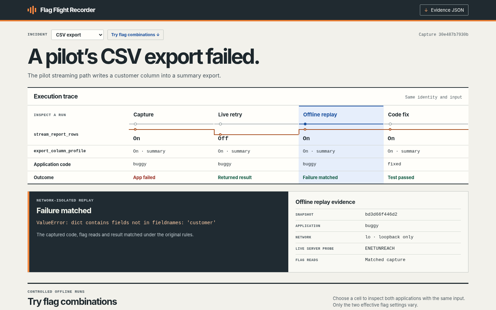

# Flag Flight Recorder

A customer’s CSV export failed. By the time a developer investigated, someone had changed a feature flag and the same request worked again. Flag Flight Recorder captures the original Flagsmith rules with the request, reproduces the failure offline, and turns it into a pytest that can verify the fix.

**[Open the interactive incident](https://raj9073.github.io/flag-flight-recorder/)** · [Download the offline viewer](https://github.com/raj9073/flag-flight-recorder/releases/download/v0.2.0/flag-flight-recorder-evidence.html) · [Release and Python package](https://github.com/raj9073/flag-flight-recorder/releases/tag/v0.2.0) · [Automated checks](https://github.com/raj9073/flag-flight-recorder/actions/workflows/verify.yml)

[](https://raj9073.github.io/flag-flight-recorder/)

## Inspect an incident

| Select a stage | What happened in the CSV example |
| --- | --- |
| Capture | A pilot requested a summary export. Streaming was on, the CSV writer raised a `ValueError`, and the application returned HTTP 500. |
| Live retry | A real Flagsmith targeting edit switched streaming off. The same customer sent the same request to the running application and received HTTP 200 with both orders. |
| Offline replay | The official Python SDK evaluated the original rules with networking disabled. The original code raised the same exception and read the same flags. |
| Code fix | The same pytest failed on the original code and passed on the fixed exporter with streaming still on. |

Open **Try flag combinations** to inspect eight offline executions. For these two orders, only streaming **on** with the **summary** profile breaks the original exporter. Each cell shows both versions’ actual outputs and flag reads. Switch incidents to examine a shipping quote backed by a regional rate-table fixture. The browser displays the recorded executions. The commands below generate fresh ones. [CSV combinations](https://raj9073.github.io/flag-flight-recorder/#csv-export/combinations) · [Shipping quote](https://raj9073.github.io/flag-flight-recorder/#shipping-quote/replay)

## Run with self-hosted Flagsmith

From a clone, use Linux, Python 3.11–3.14, uv, and Docker or Podman with Compose. Replay requires permission to create user and network namespaces. The hosted viewer and standalone HTML open in a browser on any platform.

```sh
uv sync --locked
uv run --locked flight-recorder doctor --live
uv run --locked python -m examples.stack start
uv run --locked python -m examples.demo
uv run --locked flight-recorder serve .local/demo/evidence.html
```

Open the local viewer at port 13811. The demo creates synthetic records in its own Flagsmith project, exercises `POST /exports` and `POST /quotes`, changes targeting through the management API, runs pytest twice for each fix, and prints the private capture directory. Flagsmith runs on port 13810. Its generated local sign-in stays in `.local/lab/admin.json`. [Local viewer](http://127.0.0.1:13811/) · [Local Flagsmith](http://127.0.0.1:13810/) · [Recording walkthrough](docs/recording.md)

Stop the services with `uv run --locked python -m examples.stack stop`. The database persists across restarts. Use matching `--port` and `--state` arguments on the stack and demo commands to choose a separate lab. Set `FFR_CONTAINER_ENGINE=docker` or `podman` to choose an installed engine.

## Try it in your own Python project

This example works in an empty directory. It installs the release, copies a small label handler into your project, and exercises the complete integration with a synthetic flag. It needs no Flagsmith account. Use a fresh directory so the new package and test have their own paths.

```sh
uv venv --python 3.13
. .venv/bin/activate
uv pip install pytest https://github.com/raj9073/flag-flight-recorder/releases/download/v0.2.0/flag_flight_recorder-0.2.0-py3-none-any.whl
python -c 'from pathlib import Path; import shutil, examples.starter; shutil.copytree(Path(examples.starter.__file__).parent, "myapp", ignore=shutil.ignore_patterns("__pycache__"))'
capture_id=$(python -m myapp.run)
flight-recorder list --operation render-label
flight-recorder replay "$capture_id" --registry myapp.registry:build_registry
printf '"priority"\n' > expected.json
flight-recorder export-pytest "$capture_id" --registry myapp.registry:build_registry \
  --expect expected.json --output regression
python -m pytest -q regression/test_incident.py
```

`myapp/registry.py` exposes the handler and registry to the offline worker. `myapp/run.py` owns startup and prints the capture ID. To capture against your own self-hosted instance, create and enable the boolean flag `priority_label`, set `FLAGSMITH_URL` and `FLAGSMITH_SERVER_KEY` in the application environment, then run `python -m myapp.run --live`. A key is required only to fetch a live document. [Handler and registration](examples/starter/registry.py) · [Application startup](examples/starter/run.py)

For your real endpoint, wrap a synchronous operation with `Recorder.run()` to return the handler’s result or re-raise its exception. Use `Recorder(store, registry, errors_only=True)` to save failures on that path. Explicit `record()` calls always save a capture. Declare helper source files in `Registry.register(..., sources=...)`. Supply clock readings, sampled randomness and external responses as JSON inputs or fixtures so that they can be reproduced. [HTTP integration](examples/order_service.py) · [Design and boundaries](docs/architecture.md)

## Work with a private capture

Set `FLIGHT_RECORDER_STORE` to the run’s printed `store` directory. Use `flight-recorder list` to find a capture. The viewer includes a replay command for the selected incident. A comparison needs the digest of the updated snapshot, which is listed under **Inspect source fingerprints and SDK checks**.

```sh
flight-recorder compare "$capture_id" --registry examples.registry:build_registry \
  --current "$updated_snapshot" --output comparison.json
flight-recorder explore "$capture_id" --registry examples.registry:build_registry \
  --axes examples/csv_export/axes.json --candidate-version fixed --output combinations.json
flight-recorder report comparison.json --exploration combinations.json --output incident.html
flight-recorder share comparison.json --output anonymous-summary.json
```

`report` also accepts `--before` and `--after` receipts from `flight-recorder verify`. They must agree on the capture, input, original snapshot and complete test specification. Verification checks that the chosen version reads the original flags and returns the expected result. If a refactor skips a previously read flag, strict verification fails and explains the difference.

Full reports and private test exports can contain identities, traits, outputs or sensitive rule documents. **Download anonymous summary** exports only counts and verdicts. The two downloadable tests in the public viewer use separate, synthetic snapshots. Their archive instructions specify the exact Python version used to record them.

## Verify the build

```sh
uv run --locked ruff check src examples tests
uv run --locked ruff format --check src examples tests
uv run --locked mypy
uv run --locked pytest -q
uv build --no-sources
uv run --locked --group browser python tests/browser_check.py --report .local/demo/evidence.html
```

The browser check uses the running viewer and Chrome. Use `--channel chromium` for Playwright’s installed Chromium. Continuous integration also builds the wheel, checks it outside the source checkout, and exercises the two HTTP examples with self-hosted Flagsmith. [Workflow](.github/workflows/verify.yml)

Built for Toggle Wars Track 03, **Build on Open Source Flagsmith**. Released under the MIT License. [Track description](https://www.wemakedevs.org/hackathons/flagsmith#tracks) · [Flagsmith SDK](https://docs.flagsmith.com/integrating-with-flagsmith/sdks/server-side) · [License](LICENSE)
